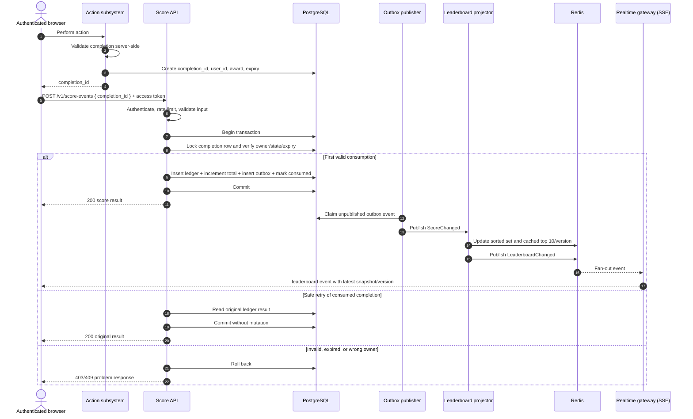

# Live Leaderboard Backend Module

## 1. Purpose

This document specifies a backend module that:

- records score increases caused by completed user actions;
- prevents clients from awarding arbitrary points or awarding points to another user;
- returns the current top 10 users;
- pushes leaderboard changes to connected browsers in near real time.

The specification is implementation-language agnostic. Examples use HTTP, JSON, PostgreSQL, Redis, and Server-Sent Events (SSE), but equivalent technologies may be substituted while preserving the guarantees below.

## 2. Scope and assumptions

### In scope

- authenticated score updates;
- validation and single-use consumption of an action completion;
- persistent user totals and an immutable score ledger;
- top-10 reads;
- live leaderboard notifications;
- concurrency, retries, abuse controls, observability, and recovery.

### Out of scope

- the business logic of the action itself;
- user registration and login implementation;
- frontend presentation;
- prizes, score redemption, seasons, and score decay.

### Assumptions

1. Users authenticate through the platform's existing identity provider. The API receives a short-lived access token and derives `user_id` from it.
2. A trusted server-side action subsystem can determine that an action was completed and how many points it is worth. If action validation currently exists only in the browser, it must be moved server-side before this design can be considered secure.
3. The initial requirement is one global, all-time leaderboard. The schema includes `board_id` so that seasons or multiple boards can be added without redesigning the module.
4. Live updates are near real time, not part of the score transaction. Durable score correctness takes priority over notification latency.

## 3. Security and correctness invariants

These rules are mandatory:

1. **Never trust scoring claims from the client.** The score API does not accept `user_id`, a new total, or a point delta.
2. **Authenticate every score mutation.** The authenticated subject is the user whose score may change.
3. **Require trusted proof of completion.** A score update requires an opaque, one-time `completion_id` created by the trusted action subsystem. The server loads its owner, award, expiry, and state from its own database. A signed grant with a unique `jti` may be used instead, but it must still be consumed exactly once.
4. **Make retries idempotent.** Reusing the same completion for the same user returns the original successful result and never awards points twice.
5. **Commit the ledger entry, aggregate total, and outbox event atomically.** A request cannot update only a subset of them.
6. **Use deterministic ranking.** Higher score wins; ties are ordered by the time the user first reached the current score, then by `user_id` ascending.
7. **Do not expose sensitive user data.** Leaderboard entries contain a public display name/avatar only.

Authorization answers *who may call the endpoint*. The trusted completion record answers *whether this specific score increase is valid*. Both checks are required.

## 4. High-level architecture

| Component | Responsibility |
|---|---|
| API gateway / middleware | TLS termination, token validation, request limits, request IDs |
| Action subsystem | Validates action completion and creates a server-owned completion record |
| Score service | Authorizes and atomically consumes completions, writes scores and outbox events |
| PostgreSQL | Source of truth for completions, score ledger, totals, and transactional outbox |
| Outbox publisher | Reliably publishes committed score changes to the event transport |
| Leaderboard projector | Updates the Redis ranking index and creates a new leaderboard version |
| Redis | Fast top-10 reads, distributed fan-out, and optional rate-limit counters |
| Realtime gateway | Maintains SSE connections and broadcasts versioned leaderboard snapshots |

PostgreSQL is authoritative. Redis is a rebuildable projection and must never be the only place a score is stored.

## 5. Execution flow

An editable diagrams.net version is available in [`score-leaderboard-flow.drawio`](./score-leaderboard-flow.drawio). It contains separate **Execution Flow** and **Component Architecture** pages.



The leaderboard projection is asynchronous. Immediately after a successful score response, the public top 10 may lag briefly; the outbox ensures it eventually catches up even after a process or broker failure.

## 6. Data model

Identifiers should be UUIDv7 (or an equivalent non-guessable, time-sortable identifier). Timestamps are UTC.

### `action_completions`

| Column | Type | Notes |
|---|---|---|
| `id` | UUID | Primary key; opaque value returned to the client |
| `user_id` | UUID | Owner; derived by the action subsystem |
| `action_type` | text | Validated action category |
| `points` | integer | Positive, server-calculated, bounded by configured policy |
| `status` | enum | `pending`, `consumed`, `expired`, `revoked` |
| `expires_at` | timestamptz | Short validity window |
| `consumed_at` | timestamptz nullable | Audit field |
| `created_at` | timestamptz | Audit field |

### `score_ledger`

Append-only audit history. Corrections are new positive or negative administrative entries; existing rows are not edited.

| Column | Type | Notes |
|---|---|---|
| `id` | UUID | Primary key / score event ID |
| `user_id` | UUID | Indexed |
| `board_id` | UUID | Board or season identifier |
| `completion_id` | UUID | Unique foreign key; enforces exactly one award per completion |
| `delta` | integer | Copied from the trusted completion |
| `balance_after` | bigint | Result returned for idempotent retries and audit |
| `created_at` | timestamptz | Indexed |

### `user_scores`

| Column | Type | Notes |
|---|---|---|
| `board_id` | UUID | Composite primary key with `user_id` |
| `user_id` | UUID | Composite primary key with `board_id` |
| `score` | bigint | Non-negative aggregate |
| `score_reached_at` | timestamptz | Updated whenever score changes; tie-break field |
| `version` | bigint | Incremented on every mutation |
| `updated_at` | timestamptz | Audit field |

### `outbox_events`

| Column | Type | Notes |
|---|---|---|
| `id` | UUID | Event ID used for downstream deduplication |
| `event_type` | text | Initially `ScoreChanged.v1` |
| `aggregate_id` | UUID | User ID |
| `payload` | jsonb | Board, user, score, version, timestamp |
| `created_at` | timestamptz | Audit field |
| `published_at` | timestamptz nullable | Set after successful publish |
| `attempt_count` | integer | Retry/dead-letter monitoring |

Required database constraints include `UNIQUE (completion_id)` on the ledger, `CHECK (points > 0)` on normal completions, and overflow-safe limits for score/delta values.

## 7. API contract

All endpoints use HTTPS, `application/json`, UTF-8, and an `Authorization: Bearer <access-token>` header unless explicitly public. Error responses use `application/problem+json` (RFC 9457). A gateway-generated `X-Request-ID` is returned on every response.

### Record an awarded score

`POST /v1/score-events`

Request:

```json
{
  "completion_id": "0191ed9c-7f18-7a7d-a778-a232f07b93c8"
}
```

Successful response (`200 OK`):

```json
{
  "score_event_id": "0191eda0-eed2-71bc-a43a-b97a2554d8dd",
  "awarded_points": 10,
  "score": 2410,
  "processed_at": "2026-08-20T19:21:43.128Z"
}
```

A retry using an already-consumed `completion_id` owned by the same authenticated user returns `200` with the original logical result. Recommended error mapping:

| Status | Code | Condition |
|---|---|---|
| `400` | `invalid_request` | Malformed UUID or body |
| `401` | `unauthenticated` | Missing, expired, or invalid access token |
| `403` | `completion_not_allowed` | Completion does not exist or does not belong to the caller; use one response to limit enumeration |
| `409` | `completion_unavailable` | Completion expired, revoked, or otherwise cannot be consumed |
| `429` | `rate_limited` | User/IP exceeds configured protection threshold |
| `503` | `temporarily_unavailable` | Source-of-truth database unavailable; client may retry with jitter |

No client-supplied `Idempotency-Key` is required because `completion_id` is the natural idempotency key. If the action subsystem calls the score service directly instead of returning the ID through the browser, the same contract and identity checks still apply through service-to-service authentication.

### Fetch the leaderboard

`GET /v1/leaderboards/{board_id}?limit=10`

- `limit` defaults to 10 and is capped at 100; the product UI uses 10.
- Public access is acceptable only if display profiles and scores are intentionally public.
- Response may be served from Redis. On a cache miss, query PostgreSQL using `ORDER BY score DESC, score_reached_at ASC, user_id ASC`, populate the cache, and return the result.

Response (`200 OK`):

```json
{
  "board_id": "0191ed91-2577-772a-8ed5-f841fa798f60",
  "version": 84721,
  "generated_at": "2026-08-20T19:21:43.640Z",
  "entries": [
    {
      "rank": 1,
      "user_id": "0191e7fd-891f-7c0b-aa84-79e7b85ba05d",
      "display_name": "Ada",
      "avatar_url": "https://cdn.example.com/avatars/ada.webp",
      "score": 9850
    }
  ]
}
```

Use `Cache-Control: public, max-age=1, stale-while-revalidate=4` only if the endpoint is public and no personalized data is included. Otherwise use `private` caching.

### Subscribe to live updates

`GET /v1/leaderboards/{board_id}/stream`

Use SSE because updates are server-to-client only, SSE reconnects natively, and it is simpler to operate through HTTP infrastructure than WebSockets. The endpoint returns `Content-Type: text/event-stream`, sends a heartbeat comment every 15–30 seconds, and enforces per-user/IP connection limits.

Example event:

```text
id: 84721
event: leaderboard
data: {"board_id":"0191ed91-2577-772a-8ed5-f841fa798f60","version":84721,"entries":[...]}
```

The initial connection sends the latest snapshot. Each subsequent event should also contain the complete top 10: the payload is small and clients cannot become corrupt by missing a delta. On reconnect, the client sends `Last-Event-ID`. If the gateway cannot replay every missed event, it immediately sends the newest snapshot. Clients ignore events whose `version` is not greater than the last applied version and should fall back to polling the GET endpoint when SSE is unavailable.

## 8. Transaction and concurrency behavior

The score service performs the following operations in one database transaction:

1. Read and lock `action_completions` by `id` (`SELECT ... FOR UPDATE`).
2. Verify `user_id` equals the authenticated subject, status is `pending`, expiry is in the future, and points comply with server policy.
3. If already consumed by this user, load and return the existing ledger row.
4. Atomically upsert `user_scores`, adding the trusted points and incrementing its version.
5. Insert one `score_ledger` row with the resulting balance.
6. Mark the completion `consumed`.
7. Insert one `ScoreChanged.v1` outbox event.
8. Commit, then respond.

The row lock plus unique ledger constraint makes concurrent duplicate requests safe. Database deadlocks or serialization failures are retried a small bounded number of times with jitter. The handler must not hold the transaction open while calling Redis, an event broker, or another network service.

The outbox publisher claims rows in batches using `FOR UPDATE SKIP LOCKED`. Delivery is at least once, so the projector deduplicates by outbox event ID and applies only a newer user score version. Marking an event published happens only after confirmed delivery. Failed events use exponential backoff and eventually enter an operator-visible dead-letter state without being deleted.

## 9. Ranking projection

Maintain one Redis sorted set per board. To preserve the exact multi-field tie-break rule, either:

- encode a carefully bounded composite rank score and test its precision; or
- store scores in Redis, then resolve ties using a secondary structure/query.

Do not rely on Redis member lexicographic order unless it matches the documented rule. For the expected top-10 workload, an alternative is to compute the top 10 from an indexed PostgreSQL query after each change that could affect the leaders and cache only the resulting snapshot. This is simpler and should be preferred until measurements justify a more complex projector.

Publish a new snapshot only when its ordered contents change. Assign each changed snapshot a monotonically increasing per-board `version`. This avoids pushing an event when a user outside the top 10 changes score but does not enter the leaderboard.

Recommended PostgreSQL index:

```sql
CREATE INDEX user_scores_rank_idx
ON user_scores (board_id, score DESC, score_reached_at ASC, user_id ASC);
```

## 10. Abuse prevention and privacy

Authentication alone does not stop a user from replaying or scripting valid-looking requests. Apply layered controls:

- verify JWT issuer, audience, signature, expiry, and allowed algorithm; never accept identity in the body;
- generate completion IDs with high entropy, keep them short-lived, bind them to user/action, and consume them once;
- calculate point awards only from server-controlled rules;
- validate the underlying action server-side and protect its endpoint against automation appropriate to the product (cooldowns, per-action limits, bot/risk signals, or CAPTCHA as a last-mile control);
- rate-limit by authenticated user, action type, and IP/device signals, with explicit handling for shared networks;
- cap award size and the number of awards per time window; alert rather than silently corrupting data;
- use service identities and least-privilege database credentials; only the score service can write score tables;
- keep an append-only audit trail, log denials, and alert on abnormal velocity, repeated completion reuse, ownership mismatches, and top-rank jumps;
- exclude access tokens, raw completion IDs, email addresses, and other sensitive fields from logs and events;
- enforce TLS, secure secret storage/rotation, retention limits, and applicable account-deletion/privacy workflows.

Rate limiting is a defense-in-depth availability control, not the basis of score correctness. Correctness comes from trusted server-side validation and one-time transactional consumption.

Administrative corrections require a separate privileged endpoint and ledger event type, protected by strong role authorization and auditable reason/ticket fields. They must not reuse the public score endpoint.

## 11. Failure handling and recovery

| Failure | Expected behavior |
|---|---|
| Client times out after commit | Retry with the same completion ID; receive the original result |
| Duplicate concurrent requests | One commits; the other returns the original result |
| Redis unavailable | Score writes continue; leaderboard reads fall back to PostgreSQL; live updates may pause |
| Publisher/projector unavailable | Outbox accumulates; replay catches the projection up after recovery |
| SSE connection drops | Browser reconnects, sends last version, and receives a current snapshot |
| Corrupt/stale cache | Rebuild a board from PostgreSQL; compare projection age/version in monitoring |
| PostgreSQL unavailable | Reject mutations with `503`; never acknowledge an uncommitted award |

A scheduled reconciliation job should compare `SUM(score_ledger.delta)` with `user_scores.score`, report discrepancies, and be able to rebuild both Redis and aggregate totals from the ledger. Reconciliation repairs should be explicit and audited.

## 12. Observability and service objectives

Every request and event carries a correlation ID. Emit structured logs and distributed traces across the API, outbox, projector, and realtime gateway.

Minimum metrics:

- request count, latency, and error rate by endpoint/status;
- successful awards, rejected completions by reason, duplicates, and rate-limit decisions;
- transaction conflicts and database latency;
- oldest unpublished outbox age, retry count, and dead-letter count;
- projector lag, cache hit ratio, and cache rebuild count;
- active SSE connections, disconnects, broadcast latency, and dropped clients;
- leaderboard snapshot age and end-to-end time from score commit to client event.

Initial service targets, to be validated against product needs and load tests:

- score mutation API: 99.9% monthly availability, p95 under 250 ms;
- leaderboard read: p95 under 100 ms from cache;
- committed score visible to connected clients: p95 under 2 seconds;
- zero acknowledged score loss and zero duplicate awards for a completion.

Alert on sustained SLO violations, outbox lag, dead letters, database saturation, and suspicious award velocity. Avoid alerting on a single transient retry.

## 13. Testing and acceptance criteria

### Required tests

- Unit tests for completion state transitions, authorization, award policy, tie-breaking, and error mapping.
- Database integration tests for atomic rollback, duplicate requests, concurrent consumption, overflow limits, and outbox insertion.
- Contract tests for JSON/problem responses and SSE event shape/version behavior.
- Projector tests for duplicate, delayed, and out-of-order events and cache rebuilds.
- Security tests for forged/expired tokens, cross-user completion IDs, enumeration resistance, replay, malformed payloads, and rate limits.
- Load tests for peak award rate, top-10 reads, reconnect storms, and many simultaneous SSE connections.
- Failure-injection tests that stop Redis/publisher/projector between transaction stages and verify eventual recovery.

### Acceptance criteria

1. A valid completion increases exactly the authenticated user's total by the configured amount.
2. The same completion submitted repeatedly or concurrently awards points exactly once and returns a stable result.
3. A user cannot award points with a fabricated, expired, revoked, or another user's completion.
4. Clients cannot select the user, delta, or resulting score.
5. Ledger, aggregate, completion state, and outbox remain consistent after any transaction failure.
6. Ranking is deterministic, limited to 10 in the product response, and matches the source-of-truth query.
7. Connected clients receive a changed top-10 snapshot within the agreed latency objective; reconnecting clients converge to the newest version.
8. Loss of Redis or the realtime path does not lose or duplicate durable score updates.
9. Dashboards and alerts reveal publication lag, projection lag, errors, and suspicious behavior.

## 14. Deployment plan

1. Deploy schema and indexes using backward-compatible migrations.
2. Deploy score service with writes disabled; exercise authentication, reads, and synthetic transactions in staging.
3. Deploy the outbox publisher/projector and validate Redis against PostgreSQL.
4. Enable score writes for internal/test users, then a small production percentage.
5. Enable SSE, retaining periodic polling as a fallback.
6. Increase traffic while observing correctness, latency, database locks, outbox lag, and connection capacity.
7. Keep a feature flag that stops new awards without disabling leaderboard reads or reconciliation.

## 15. Additional comments and improvements

These are intentionally deferred until scale or product requirements justify them:

- **Prefer direct server-to-server awarding.** If possible, let the action subsystem call the score service after validation instead of passing a completion ID through the browser. The one-time record and idempotency guarantees should remain.
- **Use PostgreSQL first.** A correctly indexed table is likely sufficient for an initial top-10 leaderboard. Add Redis ranking complexity only after load tests show a need; Redis remains useful for fan-out and caching.
- **Define score semantics explicitly.** Product and fraud teams should specify point values, maximum velocity, duplicate-action meaning, reversals, bans, season boundaries, and tie behavior before implementation.
- **Plan for seasons.** Treat `board_id` as immutable and create a new board at season rollover; archive old boards instead of rewriting history.
- **Add user-rank queries carefully.** Showing “my rank” efficiently needs separate pagination/ranking design and should not be inferred from the top-10 cache.
- **Assess WebSockets only for bidirectional features.** SSE is sufficient for this requirement. Move to WebSockets only if clients must send low-latency messages over the same channel.
- **Multi-region evolution.** Begin with a single write region. Global active-active score writes introduce ordering and tie-break complexity; adopt them only with explicit conflict semantics.
- **Formalize event schemas.** Store schema version, publish a compatibility policy, and use a registry if multiple teams consume score events.

Before implementation, the backend team should confirm expected write throughput, concurrent live connections, acceptable propagation delay, authentication provider, action-validation ownership, privacy rules, and whether the leaderboard is global or seasonal. These inputs affect capacity and policy, but not the core trust boundary or exactly-once award design.
